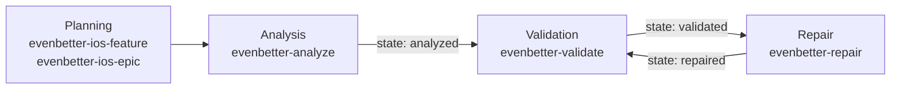

# EvenBetter

EvenBetter is a set of curated agent skills for Claude Code and Codex. The skills help an AI coding agent plan SwiftUI apps and audit them against Apple's Human Interface Guidelines (HIG) and WCAG 2.2, then fix what the audit finds, while you keep the decisions that need a person.

[Website](https://evenbetter.mellofattura.com) · [Install](#install) · [Audit workflow](#how-the-audit-works) · [Skills](#skills) · [iOS corpus](#the-ios-corpus) · [Research](#research)

## Why it exists

Ask a coding agent for a SwiftUI screen and you will usually get one that compiles and looks fine. The agent fills the gaps in your request with guesses, and the gaps are often about accessibility: VoiceOver labels, Dynamic Type, contrast, touch targets, the confirmation before a destructive action.

EvenBetter hands the agent a written procedure for the job. A planning skill asks closed questions about screens, states and accessibility before any code exists. An audit skill reads the Swift sources and ties every finding to a file and line, a rule in the EvenBetter corpus, and the Apple page that rule comes from. When a fix depends on product intent (copy, navigation, visual design), the skill asks you instead of guessing.

The skills are written and reviewed before they ship, so the agent follows a known procedure instead of making one up mid-task.

## What you get

The repository is a plugin marketplace called `evenbetter` with two plugins:

| Plugin | Skills | Covers |
| --- | --- | --- |
| `evenbetter-ios` | 16 | iOS feature and epic planning, the analyze → validate → repair audit, SwiftUI build and review guides, App Store launch and research. Ships the 49-clause iOS corpus. |
| `evenbetter-general` | 2 | The same feature and epic planning workflow, without a platform design system. |

Claude Code and Codex install the same skill files. Only the manifests differ.

## Install

### Claude Code

```text
/plugin marketplace add MelloBirkan/EvenBetterFramework
/plugin install evenbetter-ios@evenbetter
/plugin install evenbetter-general@evenbetter
/reload-plugins
```

Install only the plugin you need. Claude Code puts the plugin name in front of each skill, so the skills show up as `/evenbetter-ios:evenbetter-analyze`, `/evenbetter-ios:evenbetter-ios-feature`, `/evenbetter-general:evenbetter-general-feature` and so on.

### Codex

```bash
codex plugin marketplace add MelloBirkan/EvenBetterFramework
```

Then install the plugins from the Codex desktop app (Plugins → evenbetter → evenbetter-ios or evenbetter-general → Add to Codex), or from the CLI: run `codex`, type `/plugins`, pick the `evenbetter` marketplace and choose Install plugin. Start a new thread afterwards, then ask for what you need or mention a skill with `@`.

### Xcode tools (optional)

`evenbetter-ios` registers Xcode's MCP bridge (`xcrun mcpbridge`) as an MCP server named `xcode`. The bridge comes with Xcode 26.3 or later, and Xcode has to be running for the agent to reach it. Apple explains the setup in [Giving external agents access to Xcode](https://developer.apple.com/documentation/xcode/giving-external-agents-access-to-xcode). The skills still work without it.

`evenbetter-ios-debugger-agent` drives the simulator through XcodeBuildMCP, a separate MCP server you install yourself.

## Quick start

Open your SwiftUI project in the agent and describe the task in plain words. The agent picks the skill from your request, or you can name it.

| You ask | Skill that runs | What it leaves in your project |
| --- | --- | --- |
| "Plan a favorites screen for my iOS app" | `evenbetter-ios-feature` | `.evenbetter/<feature>/ios-ux-plan.md` and tickets |
| "Plan an iOS app for splitting household chores" | `evenbetter-ios-epic` | `.evenbetter/<epic>/` with a UX brief, screen flows, a tech plan and tickets |
| "Audit this SwiftUI app for accessibility" | `evenbetter-analyze` | `.evenbetter/<project>/evenbetter-analyze-report.html` |
| "Validate the EvenBetter report" | `evenbetter-validate` | The same report, checked and stamped `validated` |
| "Fix the critical findings" | `evenbetter-repair` | Edits to your Swift files, with each outcome recorded in the report |

Everything EvenBetter writes lands in `.evenbetter/` at the project root as plain Markdown and HTML. You can commit it next to the code or add the folder to `.gitignore`.

## How the audit works

EvenBetter splits work on an iOS app into four states: planning, analysis, validation and repair. Each state is a separate skill invocation, and each one leaves a file you can open and review.



The three audit states share one artifact, `.evenbetter/<project>/evenbetter-analyze-report.html`.

1. `evenbetter-analyze` reads the Swift sources against the corpus and writes the report. Each finding has file and line evidence, the clause it breaks, a link to Apple's documentation, a minimal fix, a recommended fix and a prompt you can hand back to the agent. If the agent can't find an Apple source for a finding, it drops the finding.
2. `evenbetter-validate` reopens the report and checks every finding against the live source, the corpus and Apple's documentation. It drops false positives, adjusts severities and rewrites any fix that wouldn't resolve the violation, then stamps the report `validated`.
3. `evenbetter-repair` goes through the validated findings by severity. It applies technical fixes in the source, such as accessibility modifiers, API updates and semantic substitutions. Product copy, navigation and visual design go back to you as closed questions with options taken from your code. Every finding ends as `applied`, `deferred`, `skipped` or `failed` in the report.

Repair won't run on a report that hasn't been validated, or on one whose validation is older than its last scan. It says which skill to run first and stops, so unchecked findings never turn into code changes.

Running `evenbetter-validate` again after a repair closes the loop. Findings that were fixed drop out of the report. If repair marked a finding as applied but the violation is still in the code, validate flips it to `failed` and the next repair run picks it up.


*The report the study participants read: Aroma Care, a SwiftUI app, after analyze and validate.*

## Skills

### evenbetter-ios

#### Planning

| Skill | Use it for |
| --- | --- |
| `evenbetter-ios-feature` | A single screen or small feature: UX plan, plan review, tickets, implementation review. |
| `evenbetter-ios-epic` | A multi-screen flow or a whole app: UX brief, screen flows, HIG tech plan, tickets. |

#### Audit

| Skill | Use it for |
| --- | --- |
| `evenbetter-analyze` | Scan the project and write the HTML report. |
| `evenbetter-validate` | Recheck the report and stamp it as validated. |
| `evenbetter-repair` | Apply the validated findings to the source. |

#### Building and reviewing SwiftUI

| Skill | Use it for |
| --- | --- |
| `evenbetter-swiftui-accessibility` | VoiceOver, Dynamic Type and WCAG rules for SwiftUI. |
| `evenbetter-swiftui-ui-patterns` | Navigation, sheets, forms, controls and layout patterns. |
| `evenbetter-swiftui-view-refactor` | Splitting oversized views and cleaning up data flow. |
| `evenbetter-swiftui-performance-audit` | Slow rendering, janky scrolling and extra view updates. |
| `evenbetter-swiftui-liquid-glass` | The iOS 26 Liquid Glass APIs. |
| `evenbetter-ios-haptics` | Matching `.sensoryFeedback` and Core Haptics to events. |
| `evenbetter-ios-app-intents` | App Intents, App Shortcuts, Siri and Spotlight. |
| `evenbetter-design` | Distinctive SwiftUI interfaces that don't look like the default iOS template. |
| `evenbetter-ios-debugger-agent` | Building, running and inspecting the app on a booted simulator. |

#### Product and launch

| Skill | Use it for |
| --- | --- |
| `evenbetter-app-opportunity-research` | Market and competitor research for an app idea, with a cited source for every claim. |
| `evenbetter-app-launcher` | App Store submission, review, pricing and launch. |

### evenbetter-general

| Skill | Use it for |
| --- | --- |
| `evenbetter-general-feature` | Feature planning and tickets for any platform. |
| `evenbetter-general-epic` | Epic planning, core flows and tickets for any platform. |

## The iOS corpus

The audit skills don't work from the model's memory of the HIG. They read a Markdown corpus that ships inside the iOS plugin, at [`plugins/evenbetter-ios/corpus/`](plugins/evenbetter-ios/corpus/). It holds 49 clauses in seven domains:

| Domain | ID prefix | Clauses | Focus |
| --- | --- | --- | --- |
| Typography | `TYPO` | 8 | Text styles, Dynamic Type, hierarchy |
| Color and theming | `CLR` | 6 | Dark Mode, contrast, semantic colors |
| Components and patterns | `COMP` | 7 | Native controls, destructive actions, feedback |
| Layout and interaction | `LAY` | 9 | Touch targets, spacing, empty and loading states |
| Navigation and flow | `NAV` | 7 | Navigation stacks, back behavior, modals |
| Accessibility | `A11Y` | 8 | Labels, grouping, traits, focus order |
| Haptics | `HAPT` | 4 | When and how to use sensory feedback |

Each clause has a stable ID such as `TYPO-UI-001`, a severity (`error`, `warning` or `info`), a dimension (UI, UX or A11Y), the source URL and the date it was retrieved. The body says what to check, why it matters to users, and what correct SwiftUI looks like. A guideline becomes a clause only if it can be observed in SwiftUI code and traced to a public Apple or W3C source. Where the sources give numbers, such as minimum touch target size or contrast ratio, the clause keeps them.

`index.json` lists every clause for lookup and has to stay in sync with the Markdown files. The format is documented in [`SCHEMA.md`](plugins/evenbetter-ios/corpus/SCHEMA.md).

## Research

EvenBetter is the subject of *Curated Agent Skills for Context-Aware Intelligent Support in iOS UX and Accessibility*, by Marcello Gonzatto Birkan, Daniela Brazolin Flauto and Valéria Farinazzo Martins (Universidade Presbiteriana Mackenzie). The paper was accepted at the 8th Workshop on Intelligent Interactive Systems (8WoSI²), part of the 12th Ibero-American Conference on Human-Computer Interaction (12JIHC'26) in Talca, Chile. The [project website](https://evenbetter.mellofattura.com) covers the study in Portuguese.

Ten iOS developers took part in a formative study. They explored the website, planned an app with an EvenBetter skill and read an audit report. They rated the workflow with a mean System Usability Scale score of 79.5 (median 81.25). All ten read the report's totals correctly, and eight ran analyze and then validate in the right order. The study looked at whether developers could understand and use the workflow. It didn't check whether every finding was technically correct, so treat a report as material for review rather than an accessibility certification.

The paper describes 17 skills. `evenbetter-repair` came later and brings the total to 18.

```bibtex
@inproceedings{birkan2026evenbetter,
  title     = {Curated Agent Skills for Context-Aware Intelligent Support in iOS UX and Accessibility},
  author    = {Gonzatto Birkan, Marcello and Brazolin Flauto, Daniela and Farinazzo Martins, Val{\'e}ria},
  booktitle = {8{\textdegree} Workshop en Sistemas Interactivos Inteligentes (8WoSI{\textsuperscript{2}}), 12{\textdegree} Jornadas Iberoamericanas de Interacci{\'o}n Humano-Computadora (12JIHC'26)},
  address   = {Talca, Chile},
  year      = {2026},
  note      = {Accepted paper}
}
```

## Updating

Claude Code:

```text
/plugin marketplace update evenbetter
/plugin update evenbetter-ios@evenbetter
/plugin update evenbetter-general@evenbetter
/reload-plugins
```

Codex:

```bash
codex plugin marketplace upgrade evenbetter
```

If the new version doesn't show up, reopen Codex or the plugin browser.

The manifests have no `version` field on purpose. Without one, Claude Code uses the git commit SHA as the version, so every commit on `main` counts as a new development release. Codex doesn't document the same fallback, so update it with `codex plugin marketplace upgrade` until the project adopts versioned releases.

## Limitations

- The platform-specific skills cover iOS only. Android will come when there are Android skills to ship.
- This is a custom GitHub marketplace. It isn't listed in either official plugin directory.
- The skills run on whatever model your agent uses, so two model versions can produce different reports from the same code. Validation catches some of this, not all.
- Installing from a private fork only works if your local Git, Claude Code or Codex setup can authenticate to it.

## Contributing

The skills that ship to users live in two places:

- `plugins/evenbetter-ios/skills/`
- `plugins/evenbetter-general/skills/`

Edit them there. Don't keep copies at the repository root.

```text
.claude-plugin/marketplace.json        Claude Code marketplace
.agents/plugins/marketplace.json       Codex marketplace
plugins/
  evenbetter-ios/
    .claude-plugin/plugin.json         Claude Code manifest
    .codex-plugin/plugin.json          Codex manifest
    .mcp.claude.json, .mcp.codex.json  Xcode MCP bridge
    corpus/                            49-clause iOS corpus and index.json
    skills/                            16 skills
  evenbetter-general/
    .claude-plugin/plugin.json
    .codex-plugin/plugin.json
    skills/                            2 skills
```

A few rules keep both hosts working:

- Only `plugin.json` goes inside `.claude-plugin/` and `.codex-plugin/`. Skills, agents, hooks and other components sit at the plugin root.
- Marketplace entries point at `./plugins/evenbetter-ios` and `./plugins/evenbetter-general`.
- Each skill has a `SKILL.md` whose frontmatter `name` matches its folder name, plus optional `references/`, `scripts/` and `agents/openai.yaml`.
- Write skills so any agent can follow them. Refer to other skills by name, not by one host's slash syntax.
- Leave `version` out of the manifests until there is a release process.

[`AGENTS.md`](AGENTS.md) lists the checks to run before you open a pull request. They validate the JSON files, compare skill names with folder names, and make sure every clause ID a skill cites exists in `index.json`.

## Documentation used

- [Claude Code plugin marketplaces](https://code.claude.com/docs/en/plugin-marketplaces)
- [Claude Code plugin manifest reference](https://code.claude.com/docs/en/plugins-reference)
- [Codex plugins](https://developers.openai.com/codex/plugins/)
- [Build Codex plugins](https://developers.openai.com/codex/plugins/build)
